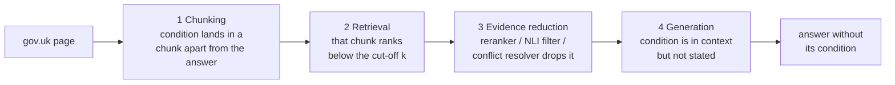

# Conditional-Answer Fidelity in Retrieval-Augmented Generation

**Attributing Condition Loss to Chunk Segmentation, Hybrid Sparse–Dense Retrieval, Evidence-Reducing Operators and
LLM Generation**

Febin K. Renu, Johann Shoni George, G. Naveen Sundar and D. Narmadha.
Karunya Institute of Technology and Sciences, Coimbatore, India.

This repository has everything behind the paper: the code, the fixed question splits, every model output, the
analysis plan committed before the evaluation, and the scripts that turn the saved outputs into every number,
table and figure in the manuscript. The manuscript is prepared for the *Journal of Trends in Computer Science
and Smart Technology* (IRO Journals).

---

## Contents

1. [The question](#1-the-question)
2. [What the study measures](#2-what-the-study-measures)
3. [Main findings](#3-main-findings)
4. [Data](#4-data)
5. [Method](#5-method)
6. [Pre-registration and deviations](#6-pre-registration-and-deviations)
7. [Repository layout](#7-repository-layout)
8. [Reproducing the results](#8-reproducing-the-results)
9. [Building the paper](#9-building-the-paper)
10. [Tests](#10-tests)
11. [Limitations](#11-limitations)
12. [Project history and legacy code](#12-project-history-and-legacy-code)
13. [Citation, licences and contact](#13-citation-licences-and-contact)

---

## 1. The question

Many answers about public services hold only under a condition. *Can I bring my other child on this visa?*
Yes, **if** that child also has or is applying for a Child Student visa. Without its condition the answer is
wrong for everyone the condition excludes, yet it sounds as confident as a correct one.

Retrieval-augmented generation (RAG) answers such questions from official guidance. A typical pipeline does
not read whole pages. It reads **chunks**, retrieves some of them, often filters or reranks them, and passes
what survives to a language model. Each step can separate an answer from the condition that limits it.

Many recent RAG modules are also built to *remove* evidence: relevance graders, contradiction filters and
conflict resolvers (for example CRAG, Astute RAG and ConflictRAG). They are evaluated where removing a passage
is right, such as misinformation. They are rarely tested where the passage that looks least relevant, or most
contradictory, is an exception to the rule beside it.

The study asks a measurement question: **where, in a chunked RAG pipeline, are the conditions of an answer
lost?**

## 2. What the study measures

A condition can be lost at four stages. The study measures each one separately:



ConditionalQA's human annotation marks every condition as an exact HTML element of its page. Chunking,
retrieval and evidence reduction can therefore be measured directly, with no language model involved.
Generation is measured with the benchmark's official metric, using **one prompt shared by every system**,
so two systems differ only in the evidence they pass to the generator.

## 3. Main findings

All figures are on English UK government guidance. Every number below is generated by
`python -m study.report` into [`results/results.json`](results/results.json) and
[`paper/numbers.tex`](paper/numbers.tex). Those files, not this README, are the authoritative record.

| Stage | Finding |
|---|---|
| **Chunking** | With 150-word chunks, the gold evidence of **72.1%** of conditional questions spans more than one chunk (42.2% of unconditional ones). For **38.7%**, some condition sits in a chunk holding nothing else the answer needs. Removing those condition-only chunks from the gold context costs **5.2** (Qwen2.5-7B) and **5.7** (Llama-3.1-8B) points of F1 with conditions. |
| **Retrieval** | No bias against conditions as such. At k = 8 the hybrid retriever finds **74.5%** of condition chunks and **74.0%** of answer chunks, but only **67.7%** of condition-only chunks. Sentence-window, parent–child, hierarchical retrieval and condition-expanded queries do not consistently improve condition coverage at the same word budget (70.0–73.4% against 72.7%), and change F1 with conditions end to end by +0.3 to +1.9 points, none significantly. |
| **Evidence reduction** | The reranker, NLI contradiction filter and ConflictRAG-style resolver remove condition chunks as readily as answer chunks. For example, reranking the top 8 down to 3 removes 17.5% of condition chunks and 19.2% of answer chunks. On RAMDocs, where discarding is right, they do not single out misinformation either: reranking keeps 66.8% of misinformation documents and 57.4% of correct ones. |
| **Generation** | Gives the largest observed deficit. With every gold condition in context, the generators state only **21.0%** (Qwen2.5-7B), **18.2%** (Llama-3.1-8B), 21.1% (gpt-oss-20b), 27.9% (Gemma-4-31B) and **32.1%** (Nemotron-3-Ultra, 550B) of the gold conditions as conditions, and most of the rest are never cited at all. A second pass asking only for conditions roughly doubles recall (21.0% → 44.0% for Qwen), but attaches conditions to 77.8% and 96.8% of unconditional answers. Five other prompting strategies, including chain-of-condition reasoning, leave recall between 11.2% and 42.5% across three generators; those that state more conditions mostly attach them to unconditional answers too. |
| **A remedy** | *Qualifier-aware context completion* adds the same-page chunks that a cross-fitted DeBERTa-v3 scorer predicts state a condition. It helps none of the five generators. Its scorer ranks condition chunks worse than the untrained reranker (AUC 0.70 vs 0.78) and does not transfer to the project's own corpus (AUC 0.36). The primary analysis uses a clean threshold protocol, in which no evaluation label shapes any threshold; the pre-registered protocol, whose threshold was chosen under a scorer trained on evaluation labels, is reported beside it and gives the same conclusion. |

### Confirmatory family

Holm-corrected within each local model on the evaluation set: 560 conditional and 400 unconditional
questions. Each entry is the paired difference in F1 with conditions, with a page-clustered BCa 95% interval.

| ID | Comparison | Qwen2.5-7B | Llama-3.1-8B |
|---|---|---|---|
| C1 | gold vs gold with condition elements deleted | +7.1 [+5.4, +9.1], p < 0.001 | +9.9 [+7.6, +12.3], p < 0.001 |
| C2 | gold vs gold without condition-only chunks | +5.2 [+2.6, +8.3], p = 0.004 | +5.7 [+2.6, +9.4], p = 0.005 |
| C3 | gold + distractors vs top-8 | +1.2 [+0.3, +2.0], p = 0.025 | +1.1 [+0.5, +1.9], p = 0.013 |
| C4 | rerank-3 vs top-8 | 0.0 [−1.6, +1.4], p = 1.000 | +1.0 [−0.5, +2.6], p = 0.690 |
| C5 | NLI filter vs top-8 | −0.3 [−1.3, +0.6], p = 1.000 | +0.6 [−0.5, +1.6], p = 0.690 |
| C6 | ConflictRAG-style vs top-8 | −0.4 [−1.4, +0.4], p = 1.000 | −0.4 [−1.5, +0.7], p = 0.690 |
| C7 | completion vs top-8 (conditional), clean threshold protocol | −0.7 [−2.0, +0.5], p = 1.000 | +1.6 [+0.2, +3.1], p = 0.134 |
| C8 | the same, unconditional, non-inferiority (margin 2 points) | +1.6 [−1.5, +4.7]: non-inferior | −2.6 [−6.1, +1.6]: not shown |
| C7^p | completion vs top-8 (conditional), pre-registered threshold | 0.0 [−1.2, +1.2], p = 1.000 | +1.3 [−0.1, +2.7], p = 0.390 |
| C8^p | the same, unconditional, non-inferiority | +3.7 [+0.8, +7.3]: non-inferior | −2.5 [−6.1, +1.2]: not shown |

The three larger hosted generators repeat the key systems on a 300-question subsample. Every main effect
keeps its direction, and the losses before generation do not shrink for them (paper, Section 4.8).

## 4. Data

| Dataset | Role | What it provides |
|---|---|---|
| [ConditionalQA v1.0](https://github.com/haitian-sun/ConditionalQA) (Sun et al., ACL 2022) | primary testbed | 652 gov.uk pages; questions with a user scenario; answers with the conditions under which each holds, annotated as exact HTML elements |
| [RAMDocs](https://huggingface.co/datasets/HanNight/RAMDocs) (Wang et al., COLM 2025) | secondary diagnostic: the regime where discarding is right | 500 questions; each document labelled correct, misinformation or noise |
| `benchmark/data/corpus.jsonl` (this project's earlier work) | out-of-distribution check of the completion scorer | 128 passage-pair instances from gov.uk immigration guidance and UK bank terms, labelled independently by two of the authors |

The benchmarks are **not** redistributed here. `python -m study.fetch_data` downloads them into
`data/external/` (gitignored) and checks every file against the SHA-256 hashes in
[`study/data_manifest.json`](study/data_manifest.json). The official ConditionalQA scorer is vendored
unchanged, with its licence, in [`third_party/conditionalqa/`](third_party/conditionalqa/).

**Question sets** (fixed before any system ran; [`study/splits.json`](study/splits.json), seed 0):

- **Tuning:** every question on 40 random training pages (209 questions). Prompts, thresholds and operator
  settings were chosen only here.
- **Evaluation:** from all other pages of the train and dev splits (the test answers are not public): all 560
  conditional and 101 unanswerable questions, plus 400 random unconditional ones. That is 1,061 questions on
  416 pages.
- **Hosted subsample:** 300 evaluation questions (150 conditional, 100 unconditional, 50 unanswerable), drawn
  with seed 0.

## 5. Method

### Chunking and retrieval

- **Chunking** (`study/cqa.py`): each page is cut into runs of whole HTML elements, packed greedily up to 150
  words, giving 6,365 chunks with a mean of 134 words. Because elements are never split, the chunk holding
  each gold condition is known exactly. Each chunk is prefixed with its page title and nearest heading for
  retrieval. Ablations use 100- and 300-word chunks, section-aware chunks (a new chunk at every top-level
  heading) and size-matched 70-word chunks.
- **Retrieval** (`study/retrieve.py`): BM25 and Contriever, fused by reciprocal rank, over all chunks of all
  pages. The ranked lists are computed once and saved, so every system and analysis reads the same rankings.

### Systems

Every system differs only in **which chunks reach the generator** (`study/systems.py`,
`study/operators.py`, `study/qualifier.py`):

| Family | System | Evidence given to the generator |
|---|---|---|
| Oracle ladder | `closed` | none (memory only) |
| | `gold` | exactly the chunks holding the annotated evidence and conditions |
| | `gold_nocondel` | the same chunks with the condition elements deleted |
| | `gold_nocondchk` | the gold chunks minus those holding only conditions |
| | `goldpad8` | all gold chunks, padded to 8 with top-ranked non-gold chunks |
| Retrieval | `top3`, `top8` | the retriever's top k (top-8 is the reference) |
| Evidence-reducing operators | `rr8to3` | cross-encoder reranker (BAAI/bge-reranker-base) keeps the best 3 of the top 8 |
| | `nli` | NLI contradiction filter (cross-encoder/nli-deberta-v3-base): drops the lower-ranked passage of a contradictory pair |
| | `crs` | ConflictRAG-style resolution: NLI-detected conflicts resolved by Entropy-TOPSIS credibility selection |
| | `grade` | relevance grading by the generator, one call per passage (RAMDocs only) |
| | `select` | listwise selection by the generator, one call (Astute-RAG style) |
| Context completion | `adj`, `page` | top 5 plus adjacent chunks, or every chunk of the top-ranked page |
| | `qc0`, `qc` | top 5 plus same-page chunks scored by the untrained reranker, or by the trained scorer |
| | `qcclean` | `qc` with each fold's scorer and threshold set without any evaluation label (clean protocol) |
| Context-preserving retrieval | `sentwin`, `parentchild` | single elements retrieved, passed with ±2 neighbours or with their top-level section, at the top 8's word budget (`study/baselines.py`) |
| | `top8` under rankers `hier`, `qexp` | pages first then their best chunks; or the query expanded with condition cue words |
| Revision diagnostics | `*_verify`, `qcoracle` | a second call that asks only for conditions; completion with a perfect scorer |
| | `gold_p<variant>` | the gold context under five other prompting strategies (`study/prompts.py`) |

### Generator, metric and statistics

- **Generator** (`study/reader.py`): one prompt and one JSON output contract for every system. The context is
  given as numbered lines (one per HTML element). The model returns short answers, each with the lines that
  state an unresolved condition. Those line numbers map back to the exact element strings that the official
  metric scores. Decoding is greedy (temperature 0), and the prompt hash is recorded in every output file.
- **Primary metric:** ConditionalQA's official **F1 with conditions**, computed by the authors' `evaluate.py`,
  unchanged (`study/scoring.py`). It multiplies answer token F1 by the F1 of exact condition-element matches.
  A condition stated where the gold has none scores zero, and extra answers are penalised, so verbosity
  cannot raise the score.
- **Secondary measures:** answer F1 and exact match, condition precision and recall, how each gold condition
  in context is handled (stated as a condition, cited only as evidence, or not cited), false conditions on
  unconditional answers, and RAMDocs strict accuracy.
- **Statistics** (`study/stats.py`, `study/confirm.py`): questions on one page share chunks and retrieval
  behaviour, so the **page** is the resampling unit. Paired differences get page-clustered BCa intervals
  (2,000 resamples) and page-level sign-flip permutation tests (20,000 flips). The confirmatory family is
  Holm-corrected within each model.

### Models

| Generator | Where it runs | Role |
|---|---|---|
| Qwen2.5-7B-Instruct (Q4_K_M) | local, Ollama | full matrix |
| Llama-3.1-8B-Instruct (Q4_K_M) | local, Ollama | full matrix |
| gpt-oss-20b | Groq, then NVIDIA's API once Groq's daily quota is spent | replication on the hosted subsample |
| Gemma-4-31B | NVIDIA's API | replication |
| Nemotron-3-Ultra (550B MoE, 55B active, reasoning off) | NVIDIA's API | replication |
| Qwen3.8-27B | Groq | prompt tuning only |

The local generators ran on a laptop with an 8 GB RTX 4060 and 16 GB of RAM. Every hosted answer records the
provider that served it. A provider-agreement check (gpt-oss-20b answered again on NVIDIA) is in
`study/runs/provider_check/`.

## 6. Pre-registration and deviations

[`study/ANALYSIS_PLAN.md`](study/ANALYSIS_PLAN.md) fixes the question sets, pipeline settings, metrics,
models, statistics and the confirmatory family C1–C8. It and the tuning-set decisions were committed as
`b435681` and `1ed2e83`, before the first evaluation answer was generated. Every later change is listed there
as a dated deviation, with its reason:

1. **Serving providers.** When Groq's daily quota for gpt-oss-20b is spent, the same open-weight model is
   called on NVIDIA's API with identical settings.
2. **Hosted models.** gpt-oss-120b and Qwen 27B would each have needed about twelve more days on Groq alone,
   so they were replaced by models that NVIDIA serves, before any hosted analysis.
3. **Third hosted rung.** Mistral-Large-4's reasoning used up the token limit without answering, so the rung
   became Nemotron-3-Ultra with its reasoning off. This was decided before any of its answers were scored.
4. **Revision diagnostics** (exploratory). These are:
   - a condition-verification second pass;
   - oracle completion;
   - section-aware chunks end to end;
   - the provider-agreement check;
   - an audit of exact element matching;
   - local versus hosted contrasts on identical questions.

5. **Sixth review round** (exploratory, 2026-11-18):
   - prompt robustness: five condition-aware prompting strategies besides the frozen one, with the gold
     context and with the condition-only chunks removed (`study/prompts.py`);
   - context-preserving retrieval: sentence window, parent–child, hierarchical and query expansion
     (`study/baselines.py`);
   - a clean threshold protocol for completion, in which no evaluation label shapes any threshold
     (`python -m study.qualifier clean`);
   - semantic condition matching with the NLI model (`study/semantic.py`).

6. **Primary completion analysis** (2026-11-18): because the pre-registered threshold was chosen under a scorer
   trained on evaluation labels, the clean protocol is reported as C7 and C8, with Holm recomputed, and the
   pre-registered protocol beside it as C7^p and C8^p. The conclusion is the same under both.

The diagnostics are exploratory, and none changes a confirmatory conclusion.
[`paper/response_to_reviewers.md`](paper/response_to_reviewers.md) records seven rounds of review and the
response to each point.

## 7. Repository layout

### The study

```
study/
  ANALYSIS_PLAN.md       analysis plan, committed before the evaluation; deviations at the end
  fetch_data.py          download ConditionalQA and RAMDocs, verify by SHA-256 (data_manifest.json)
  cqa.py                 ConditionalQA as chunked open retrieval: pages, elements, chunks, splits
  splits.json            the fixed tuning / evaluation / hosted question sets
  retrieve.py            BM25, Contriever and hybrid rankings (saved in artifacts/rankings/)
  systems.py             oracle ladder and retrieval systems
  operators.py           reranker, NLI filter, ConflictRAG-style, grading, listwise selection
  qualifier.py           cross-fitted DeBERTa-v3 qualifier scorer and context completion
  reader.py              the single generator prompt, output contract and parser
  run.py                 run one cell (system x model x question set); resumable
  schedule.py            run the local matrix or the hosted replication
  revision.py            diagnostics added in revision
  prompts.py             prompt robustness: five more prompting strategies (sixth review round)
  baselines.py           context-preserving retrieval designs (sixth review round)
  semantic.py            NLI-based semantic matching of missed conditions (sixth review round)
  round6.py              results of the sixth-round analyses, for report.py
  probe.py               small tuning sample for checking a model before spending quota
  ramdocs.py, ram.py     RAMDocs loader and runner (documents always in reranker order)
  ood.py                 out-of-distribution check on the project's own corpus
  scoring.py             wraps the official ConditionalQA evaluate.py
  stats.py, confirm.py   page-clustered inference; the confirmatory family C1-C8
  analysis.py            per-cell score tables
  report.py              every reported number -> results/results.json, paper/numbers.tex, paper/tables/
  figures.py             the paper's figures, from results.json only
  runs/                  every model output: one JSON line per question per cell
    eval/  hosted/  ramdocs/  provider_check/  tuning*/
  artifacts/
    rankings/            saved ranked lists
    operators/           saved decisions of the model-free operators
    semantic/            saved NLI scores for semantic condition matching
    qualifier/           out-of-fold scorer outputs, threshold and OOD scores (checkpoints not committed)
results/results.json     the record of every number
third_party/conditionalqa/  official scorer, unchanged, with licence
```

### The paper

```
paper/
  main.tex, sections/, tables/, figures/   manuscript sources (tables and numbers.tex are generated)
  numbers.tex             one LaTeX macro per reported number; nothing in the text is typed by hand
  review.tex              anonymised review copy (no authors or biographies)
  check_paper.py          journal limits and project rules (pages, references, abstract, hand-typed numbers)
  check_tables.py         rescoring of Tables 4 and 7 from the raw outputs with the official evaluate.py
  make_docx.py            Word version built from the same sources
  make_submission.py      LaTeX source .zip for the journal, test-compiled from the unpacked package
  references_verified.md  every reference checked against its primary source, and what it may be cited for
  response_to_reviewers.md  five review rounds and the response to each point
```

### Modules reused from the earlier project

| Module | Used for |
|---|---|
| `retrieval/` | BM25, Contriever and reciprocal-rank fusion (`HybridRetriever`) |
| `detection/nli.py` | the cross-encoder NLI model behind the contradiction filter |
| `baselines/conflictrag_topsis.py` | Entropy-TOPSIS credibility selection for the ConflictRAG-style resolver |
| `metrics/cluster.py`, `metrics/stats.py` | BCa intervals, Holm correction |
| `api_budget/` | one client for Ollama, Groq and NVIDIA: response cache, retries that honour rate-limit hints, cost log, provider fallback |
| `settings.py`, `config/models.yaml`, `config/ollama/` | model tiers, providers and the two local Ollama Modelfiles |
| `benchmark/`, `contract/` | the 128-instance corpus and its loaders, used only for the out-of-distribution check |

Everything else at the top level belongs to the earlier project; see [Section 12](#12-project-history-and-legacy-code).

## 8. Reproducing the results

There are two levels. Level 1 recomputes every number from the saved outputs in minutes, without a GPU,
models or API keys. Level 2 reruns the models.

### Setup

Python 3.11.

```bash
python -m venv .venv
source .venv/bin/activate            # Windows: .venv\Scripts\activate
pip install torch --index-url https://download.pytorch.org/whl/cu124   # Level 2 only; CPU torch works for Level 1
pip install -r requirements.txt
python -m study.fetch_data           # downloads ConditionalQA and RAMDocs, verifies hashes
```

### Level 1: every number from the saved outputs

```bash
python -m study.report       # results/results.json, paper/numbers.tex, paper/tables/*.tex
python -m study.figures      # paper/figures/*.pdf
python -m study.confirm      # prints the confirmatory family
python paper/check_tables.py # independent rescoring of Tables 4 and 7 with the official evaluate.py
```

This uses only the committed model outputs (`study/runs/`), rankings and operator decisions
(`study/artifacts/`) and the fetched benchmarks. On a fresh clone, `study.report`, `study.figures` and
`check_tables.py` reproduce the committed `results.json`, `numbers.tex`, tables and figures byte for byte;
`git status` stays clean. The table check reports 81 of 81 values matching.

### Level 2: rerunning the models

Local generators: install [Ollama](https://ollama.com) and create the two tagged models (temperature 0,
seed 0, 8,192-token context):

```bash
ollama pull qwen2.5:7b-instruct-q4_K_M
ollama pull llama3.1:8b-instruct-q4_K_M
ollama create scopecompose-qwen7b -f config/ollama/backbone7b.Modelfile
ollama create scopecompose-reader -f config/ollama/reader.Modelfile
```

Hosted generators: copy `.env.example` to `.env` and fill in `GROQ_API_KEY`, `NVIDIA_API_KEY` and,
optionally, a standby `NVIDIA_API_KEY_2`. Free tiers suffice but are slow. `.env` is gitignored.

Then, in order:

```bash
python -m study.retrieve                       # rankings (Contriever on the GPU)
python -m study.retrieve --strategy section    # section-aware chunks, for the ablation
python -m study.operators --dataset cqa        # model-free operator decisions on ConditionalQA
python -m study.operators --dataset ramdocs    # ... and on RAMDocs
python -m study.schedule local                 # trains and scores the qualifier folds, then every
                                               # ConditionalQA and RAMDocs cell for both local models
python -m study.schedule hosted                # replication cells, paced to the providers' quotas
python -m study.revision local                 # revision diagnostics, local
python -m study.revision hosted                # revision diagnostics, hosted, and the provider check
python -m study.ood                            # out-of-distribution check of the scorer
python -m study.qualifier clean                # sixth round: clean-protocol scorers (GPU), then
python -m study.run --system qcclean --model qwen7b llama8b --set eval
python -m study.baselines rank                 # element, page and expanded-query rankings
python -m study.baselines run                  # the four retrieval designs, both local models
python -m study.prompts local                  # five prompting strategies, local models
python -m study.prompts hosted --model nemotron
python -m study.semantic                       # NLI scores for semantic matching
python -m study.report && python -m study.figures
```

- **Resuming:** every cell is resumable. An interrupted run continues where it stopped, and a cell file that
  already holds answers from a different model, prompt or chunking is refused. Because the committed outputs
  are complete, rerunning a cell is a no-op. To regenerate from scratch, move `study/runs/` aside first.
- **Single cells:** for example `python -m study.run --system top8 --model qwen7b --set eval`, or
  `python -m study.ram --system full oracle --model qwen7b`.
- **Expected variation:** local decoding is greedy with a fixed seed, but hosted APIs are not guaranteed to be
  deterministic, so hosted reruns may differ slightly.

## 9. Building the paper

The manuscript compiles with [Tectonic](https://tectonic-typesetting.github.io) (or any XeLaTeX or pdfLaTeX
installation):

```bash
cd paper
tectonic -X compile main.tex       # main.pdf, 25 pages, with authors and biographies
tectonic -X compile review.tex     # review.pdf, anonymised review copy
python check_paper.py              # pages <= 25, references <= 25, abstract 150-250 words,
                                   # citation order, no hand-typed numbers, no overfull lines
python check_tables.py             # tables against the raw outputs
python make_docx.py                # submission/Conditional_Answer_Fidelity_in_RAG.docx (25 pages in Word)
python make_submission.py          # submission/..._LaTeX_source.zip, test-compiled
```

`paper/submission/` is gitignored, since both files are rebuilt from the sources. `make_docx.py` uses a
bundled pandoc (`pypandoc_binary`) and `python-docx`, both in `requirements.txt`.

## 10. Tests

```bash
pytest -m "not slow and not network"
```

The full suite (2,003 tests) passes. `slow` tests need a model download or a GPU, and `network` tests call a
live API. The study's own tests are `tests/test_study.py`, `tests/test_study_confirm.py`,
`tests/test_study_routes.py` and `tests/test_pivot_regressions.py`. They cover the chunker's element
preservation, splits, scoring against the official script, cell resumption and refusal, the confirmatory
statistics, and regression tests for bugs fixed before the study.

## 11. Limitations

These are stated in the paper too:

- ConditionalQA's own human agreement is 56.6 F1 with conditions, so part of the gap is annotation noise.
  Its metric credits a condition only when the exact element is cited.
- The two primary generators are small and 4-bit quantised. The larger hosted ones replicate direction on a
  subsample and differ in architecture, training and serving as well as size. They are not a controlled
  scaling experiment.
- Each operator is an implementation of a published method's evidence-reducing step, not the complete
  system. The ConflictRAG-style resolver implements three of the original five credibility criteria.
- One generator prompt was frozen for every system. Six prompting strategies were compared in revision, but
  they do not span every reasonable prompt, so the generation finding is a claim about those strategies.
- No human-validated sample of the metric's false negatives was drawn; token-overlap and NLI-based matching
  both leave the conclusion unchanged.
- RAMDocs mixes conflict with ambiguity, and its misinformation is synthetic.
- All texts are English UK government guidance. Healthcare, financial and legal documents are structured
  differently, and the conclusions are claims about structured policy guidance.

The systems' answers concern eligibility for public services. They are not legal or official advice, and
neither are the benchmark's own answers.

## 12. Project history and legacy code

The repository began as **ScopeCompose**, a final-year project titled *Beyond Source Selection: Detecting and
Resolving Conditional Knowledge Conflicts in RAG*. It built a pipeline to detect conditional conflicts,
extract their conditions and compose scoped answers. That design depended on cross-document rule/exception
pairs, which proved rare (14 natural instances), on an unvalidated headline metric, and on new human
annotation. Its one head-to-head comparison had the pipeline below plain full-context generation.

In November 2026 the project pivoted to the measurement study above, which needs no new annotation and is
large enough for proper statistics. The reasons are recorded in [`PROGRESS.md`](PROGRESS.md), under
2026-11-14.

The earlier code is kept because the study reuses parts of it (Section 7) and as the record of that work. It is
**not** part of the paper's pipeline:

| Path | What it is |
|---|---|
| `detection/`, `scope/`, `extraction/`, `composition/`, `generation/`, `pipelines/`, `qnfa/` | the ScopeCompose pipeline (detection, scope relations, condition extraction, composition) |
| `benchmark/`, `contract/` | the earlier benchmark: corpus, annotation manual, mining, splits, the frozen JSON contract |
| `experiments/`, `reporting/`, `release/`, `prereg/`, `scripts/` | experiment runners, reporting, release bundle and pre-registration of the earlier design |
| `service/`, `site/`, `start.bat`, `start.sh`, `start.command` | a local demo service and a project website (the GitHub workflow builds the site; deployment is disabled) |
| `plan_v7/`, `docs/`, `review.txt` | earlier proposals, reviews, decision records and a probe-verification sheet (see [`docs/README.md`](docs/README.md)) |
| `CONVENTIONS.md` | working conventions; the study-relevant rules are summarised there |

## 13. Citation, licences and contact

The paper is not yet published. Until it is, please cite it as:

```bibtex
@unpublished{renu2026conditions,
  title  = {Conditional-Answer Fidelity in Retrieval-Augmented Generation: Attributing Condition
            Loss to Chunk Segmentation, Hybrid Sparse-Dense Retrieval, Evidence-Reducing Operators
            and {LLM} Generation},
  author = {Renu, Febin K. and George, Johann Shoni and Sundar, G. Naveen and Narmadha, D.},
  note   = {Manuscript prepared for the Journal of Trends in Computer Science and Smart Technology},
  year   = {2026}
}
```

**Licences:**
- ConditionalQA is distributed by its authors under its own licence. Its scorer is vendored with that licence
  in `third_party/conditionalqa/`.
- RAMDocs is distributed under the MIT licence.
- The models are used under their providers' terms.

**Contact:** Johann Shoni George (corresponding author), johannshoni@karunya.edu.in.
